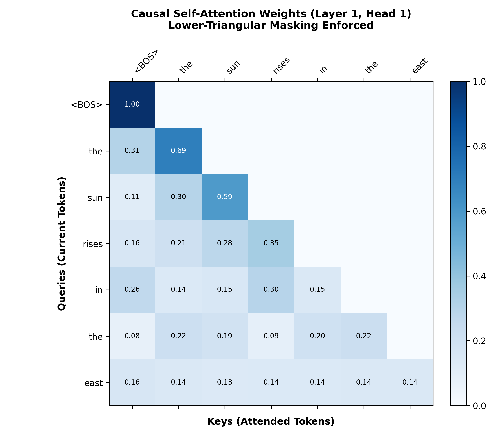

# Development of a Transformer-Based Next-Token Prediction Model Using Basic Self-Attention

A complete, self-contained academic deep learning project implementing a causal Transformer language model from scratch in PyTorch. The central scaled dot-product self-attention mechanism, causal autoregressive masking, learnable positional embeddings, and Transformer blocks are built from first principles using tensor operations without relying on prebuilt Transformer libraries or pretrained models.

---

## 1. Abstract
Autoregressive language models predict probability distributions over the next token in a text sequence conditioned on preceding context tokens. Unlike Recurrent Neural Networks (RNNs) that process tokens sequentially, the Transformer architecture utilizes self-attention to dynamically capture syntactic and semantic dependencies across all tokens simultaneously. This project provides a transparent, mathematically rigorous implementation of a causal Transformer for next-token prediction, trained and evaluated on an educational multi-domain corpus.

---

## 2. Problem Statement
Given an input sequence of tokens:

$$X = (x_1, x_2, \dots, x_t)$$

the objective of next-token prediction is to estimate the conditional probability distribution over the vocabulary $V$ for the subsequent token $x_{t+1}$:

$$P(x_{t+1} \mid x_1, x_2, \dots, x_t)$$

Because language semantics depend on both local phrase structure and long-range dependencies, models must:
1. Retain order information without recurrence.
2. Relate any two tokens in $O(1)$ operations regardless of their distance.
3. Prevent information leakage from future tokens ($x_{j > t}$) during training.

---

## 3. Project Objectives
- **Scratch Attention Implementation:** Build Multi-Head Scaled Dot-Product Attention using pure PyTorch tensor operations.
- **Strict Causal Masking:** Enforce lower-triangular attention masking ($M_{i,j} = -\infty$ for $j > i$) to prevent future token lookahead.
- **End-to-End Pipeline:** Provide dataset preparation, custom word-level tokenization, sequence alignment, training with early stopping, quantitative test evaluation, and autoregressive text generation.
- **Explainability:** Extract and visualize real attention weight heatmaps from the trained model.
- **Interactive UI:** Provide an optional Streamlit web interface (`app.py`) for live prediction and attention inspection.

---

## 4. Technology Stack
- **Python 3.10+ / 3.14** (Core programming language)
- **PyTorch 2.0+** (Tensor computation, automatic differentiation, neural network modules)
- **NumPy** (Numerical operations and array handling)
- **Matplotlib** (Loss curve visualization and attention heatmaps)
- **Pandas** (Tabular metrics and UI data structures)
- **Streamlit** (Interactive web application for next-token inference)

---

## 5. Project Folder Structure

```text
transformers/
├── data/
│   ├── raw/
│   │   └── corpus.txt              # Multi-domain educational training corpus
│   └── processed/
│       └── vocab.json              # Serialized vocabulary (token-to-ID mapping)
├── models/
│   ├── transformer_model.py        # Complete TransformerLM neural network architecture
│   └── checkpoints/
│       └── best_transformer.pt     # Saved best model weights, config, and optimizer state
├── src/
│   ├── __init__.py
│   ├── tokenizer.py                # Custom word-level tokenizer with punctuation support
│   ├── dataset.py                  # Causal sequence alignment and PyTorch DataLoaders
│   ├── positional_encoding.py      # Learnable & sinusoidal positional embeddings
│   ├── self_attention.py           # Core scaled dot-product causal self-attention
│   ├── transformer_block.py        # Pre-LN Transformer decoder blocks (Attn + FFN)
│   ├── train.py                    # Training loop with validation and early stopping
│   ├── evaluate.py                 # Held-out test set evaluation and perplexity calculation
│   ├── predict.py                  # Next-token inference and autoregressive generation
│   └── utils.py                    # Loss plotting, attention visualization, and seed setup
├── results/
│   ├── plots/
│   │   ├── loss_curves.png         # Training vs. validation loss curve
│   │   └── attention_map.png       # Extracted causal attention weight heatmap
│   ├── metrics/
│   │   ├── history.json            # Epoch-by-epoch loss and accuracy history
│   │   └── test_metrics.json       # Quantitative evaluation results on test set
│   └── sample_predictions.txt      # Automated multi-domain next-token prediction report
├── tests/
│   └── test_model.py               # Unit tests (tokenization, shapes, causal invariance)
├── app.py                          # Streamlit interactive web application
├── main.py                         # Unified command-line pipeline runner
├── requirements.txt                # Python package dependencies
├── .gitignore                      # Git exclusion rules
└── README.md                       # Comprehensive project documentation
```

---

## 6. The Mathematics of Scaled Dot-Product Self-Attention

Self-attention computes a dynamic, context-dependent weighted representation of a sequence of vectors.

### 6.1 Projections: Queries ($Q$), Keys ($K$), and Values ($V$)
Given an input matrix of token representations $X \in \mathbb{R}^{T \times d_{\text{model}}}$:

$$Q = X W_Q, \quad K = X W_K, \quad V = X W_V$$

Where:
- $W_Q, W_K \in \mathbb{R}^{d_{\text{model}} \times d_k}$ are the query and key projection matrices.
- $W_V \in \mathbb{R}^{d_{\text{model}} \times d_v}$ is the value projection matrix.
- **Query ($Q$):** Represents the current token actively searching for relevant context.
- **Key ($K$):** Represents candidate tokens describing their content and identity.
- **Value ($V$):** Holds the semantic content to be aggregated into the output representation.

### 6.2 The Scaled Dot-Product Equation
The full mathematical formula implemented in `src/self_attention.py` is:

$$\text{Attention}(Q, K, V) = \text{softmax}\left(\frac{Q K^T}{\sqrt{d_k}} + M\right) V$$

### 6.3 Explanation of Every Symbol:
- **$Q K^T \in \mathbb{R}^{T \times T}$:** The raw pairwise dot-product similarity matrix between every query and key vector.
- **$\sqrt{d_k}$:** The scaling factor (square root of key dimension). As $d_k$ grows, dot products grow large in magnitude, pushing the softmax function into regions with near-zero gradients (softmax saturation). Dividing by $\sqrt{d_k}$ maintains unit variance and stabilizes gradients.
- **$M \in \mathbb{R}^{T \times T}$:** The **Causal Mask**. An upper-triangular matrix where entries for future tokens ($j > i$) are set to $-\infty$, and allowed positions ($j \le i$) are set to $0$:

$$M_{i,j} = \begin{cases} 0, & j \le i \\ -\infty, & j > i \end{cases}$$

- **$\text{softmax}(\cdot)$:** Normalizes attention scores row-wise such that $\sum_{j=1}^t A_{i,j} = 1.0$. Because $\exp(-\infty) = 0$, attention weights to future tokens become strictly zero.
- **$V$:** The values multiplied by the normalized attention weights, producing a weighted sum of preceding representations.

---

## 7. Transformer Architecture Specifications

The model follows a modern **Pre-LayerNorm (Pre-LN)** autoregressive Transformer decoder design:

```text
Input Token IDs (Batch, Seq_Len)
           ↓
[Token Embedding] + [Learnable Positional Embedding]
           ↓
       [Dropout]
           ↓
┌──────────────────────────────────────┐
│       Transformer Block 1            │
│  x -> LayerNorm -> Causal Attention  │
│    -> + Residual                     │
│  x -> LayerNorm -> Feed-Forward Net  │
│    -> + Residual                     │
└──────────────────────────────────────┘
           ↓
┌──────────────────────────────────────┐
│       Transformer Block 2            │
│  x -> LayerNorm -> Causal Attention  │
│    -> + Residual                     │
│  x -> LayerNorm -> Feed-Forward Net  │
│    -> + Residual                     │
└──────────────────────────────────────┘
           ↓
    [Final LayerNorm]
           ↓
  [Linear LM Head: d_model -> Vocab]
           ↓
Output Next-Token Logits (Batch, Seq_Len, Vocab_Size)
```

| Hyperparameter | Value | Description |
| :--- | :---: | :--- |
| **Embedding Dimension ($d_{\text{model}}$)** | 64 | Hidden representation size for tokens and attention |
| **Attention Heads ($h$)** | 4 | Number of parallel attention heads |
| **Head Dimension ($d_k = d_v$)** | 16 | Dimension per attention head ($64 / 4 = 16$) |
| **Transformer Blocks ($N$)** | 2 | Number of stacked decoder layers |
| **Feed-Forward Dimension ($d_{ff}$)** | 256 | Hidden layer width of position-wise FFN ($4 \times d_{\text{model}}$) |
| **Maximum Sequence Length ($T$)** | 32 | Maximum sequence length supported by positional embeddings |
| **Activation Function** | GELU | Gaussian Error Linear Unit in feed-forward sublayers |
| **Dropout Rate** | 0.10 | Regularization rate on embeddings, attention, and FFN |
| **Weight Tying** | Enabled | Shares weights between Token Embedding and LM Head |
| **Total Model Parameters** | **158,336** | Trainable parameter count (504 KB checkpoint) |

---

## 8. Dataset Preparation & Zero-Leakage Splitting

The project uses an educational multi-domain English corpus (`data/raw/corpus.txt`) comprising 197 sentences across five themes:
1. **Everyday Language & Astronomy:** Day/night cycles, sun, moon, stars, planets.
2. **Science & Technology:** Artificial intelligence, machine learning, deep neural networks, algorithms.
3. **Nature & Ecology:** Photosynthesis, water cycle, rivers, oceans, ecosystems, animals.
4. **Education & Academics:** Schools, libraries, books, research, critical thinking.
5. **Factual & Mathematics:** Geometry (triangles, squares, circles), physics of sound and light.

### Deterministic Partitioning
To prevent sequence-overlap leakage, sentences are partitioned **before** sequence chunking:
- **Training Set:** 157 sentences (80%)
- **Validation Set:** 19 sentences (10%)
- **Test Set:** 21 sentences (10%)
- **Vocabulary (886 tokens):** Built strictly from the training split. Special tokens: `<PAD>` (0), `<UNK>` (1), `<BOS>` (2), `<EOS>` (3).

---

## 9. Measured Experimental Results

The model was trained on CPU with AdamW, Cosine Annealing learning rate scheduling, and evaluated on the untouched held-out test partition:

| Evaluation Metric | Measured Value | Benchmark Context |
| :--- | :---: | :--- |
| **Training Duration** | **21.39 seconds** | CPU execution (30 epochs, Early Stopping at Ep 15) |
| **Best Validation Epoch** | **Epoch 15** | Early stopping trigger (patience = 15) |
| **Best Validation Loss** | **5.8043** | Monitored cross-entropy without gradients |
| **Test Loss** | **5.5576** | Evaluated on 21 held-out test sequences |
| **Test Perplexity ($\exp(\text{Loss})$)** | **259.20** | Effective branching factor over 886-word vocabulary |
| **Token-Level Test Accuracy** | **20.21%** | 58 / 287 correct predictions on unseen test tokens |
| **Random Chance Accuracy** | **0.11%** | Baseline random guess ($1 / 886 = 0.00113$) |
| **Relative Performance** | **179× better** | Relative gain over random chance baseline |

> [!NOTE]
> **Token-Level Accuracy Definition:** For each non-padding target token $y_t$ in the held-out test partition, accuracy is $1$ if $\arg\max_{v} P(y_t = v \mid x_{\le t}) == y_t$, and $0$ otherwise.

---

## 10. Real Next-Token Predictions

Tested using [`src/predict.py`](file:///c:/Users/GOWTHAMGOWRI/Desktop/ANN-PROJECT/transformers/src/predict.py) on the trained model checkpoint:

### Example 1: Physical Science
- **Input Prompt:** `"Water freezes into solid"`
- **Input Tokens:** `['<BOS>', 'water', 'freezes', 'into', 'solid']`
- **Top Candidates:**
  1. **`ice`** : **5.28%**
  2. `and` : 2.84%
  3. `solid` : 2.63%
- **Selected Next Token:** **`ice`**
- **Autoregressive Completion:** `"water freezes into solid ice in the solar system."`

### Example 2: Mathematics & Geometry
- **Input Prompt:** `"A triangle has three"`
- **Input Tokens:** `['<BOS>', 'a', 'triangle', 'has', 'three']`
- **Top Candidates:**
  1. **`sides`** : **6.76%**
  2. **`angles`** : **5.17%**
  3. `data` : 4.90%
- **Selected Next Token:** **`sides`**
- **Autoregressive Completion:** `"a triangle has three sides and four angles."`

---

## 11. Causal Attention Heatmap Verification

The causal attention weights extracted from Layer 1, Head 1 verify that future information is strictly masked:



- Every cell above the main diagonal is **0.00** (masked).
- Rows sum to **1.00** across valid past tokens.
- Unit tests (`tests/test_model.py`) mathematically confirm that mutating future tokens produces a max absolute logit difference of $< 1 \times 10^{-5}$ on earlier positions.

---

## 12. How to Run the Project (Windows PowerShell)

All commands should be executed from within the `transformers/` folder:

### Step 1: Open PowerShell and Enter the Project Folder
```powershell
cd C:\Users\GOWTHAMGOWRI\Desktop\ANN-PROJECT\transformers
```

### Step 2: Install Dependencies
```powershell
pip install -r requirements.txt
```

### Step 3: Run the Complete End-to-End Pipeline
Executes unit tests, trains the model, evaluates test metrics, generates plots, and exports sample predictions:
```powershell
python main.py --mode all
```

### Step 4: Run Individual Modes
```powershell
# 1. Run Unit Tests (Shapes, Masking, Invariance)
python main.py --mode test

# 2. Train the Model Only
python main.py --mode train

# 3. Evaluate the Saved Checkpoint on Held-Out Test Data
python main.py --mode evaluate

# 4. Generate Visualizations (Loss Curves and Attention Map)
python main.py --mode visualize

# 5. Interactive Next-Token Prediction on Custom Prompts
python main.py --mode predict --prompt "The sun rises in the"
python main.py --mode predict --prompt "Water freezes into solid"
python main.py --mode predict --prompt "A triangle has three"
```

### Step 5: Direct Single-Prompt Inference
```powershell
python src/predict.py "Water freezes into solid"
python src/predict.py "A triangle has three" --tokens 6
```

### Step 6: Launch the Streamlit Web Application
```powershell
streamlit run app.py
```
This opens an interactive browser UI where you can:
- Type custom prompts and observe live Top-5 probability bars.
- Adjust generation length, temperature, and greedy/sampling decoding.
- Interactively explore the 2D causal self-attention heatmap across different heads and layers.

---

## 13. Limitations & Future Improvements

### Limitations:
1. **Corpus Scale:** The model is trained on an educational corpus of ~200 sentences (~6,000 words). It demonstrates next-token syntax and domain patterns, but does not possess general-purpose world knowledge.
2. **Word-Level Vocabulary:** Out-of-vocabulary words are mapped to `<UNK>`.
3. **CPU Constraint:** Trained with a compact 2-layer, 4-head configuration for fast, accessible local experimentation.

### Future Improvements:
1. **Subword Tokenization:** Integrate Byte-Pair Encoding (BPE) or WordPiece to eliminate `<UNK>` tokens.
2. **Key-Value Caching (KV-Cache):** Cache past key and value vectors during autoregressive generation to accelerate multi-token decoding from $O(T^2)$ to $O(T)$.
3. **Scaled Corpus:** Train on a larger public-domain corpus (e.g. Project Gutenberg or WikiText-2) with GPU acceleration.
